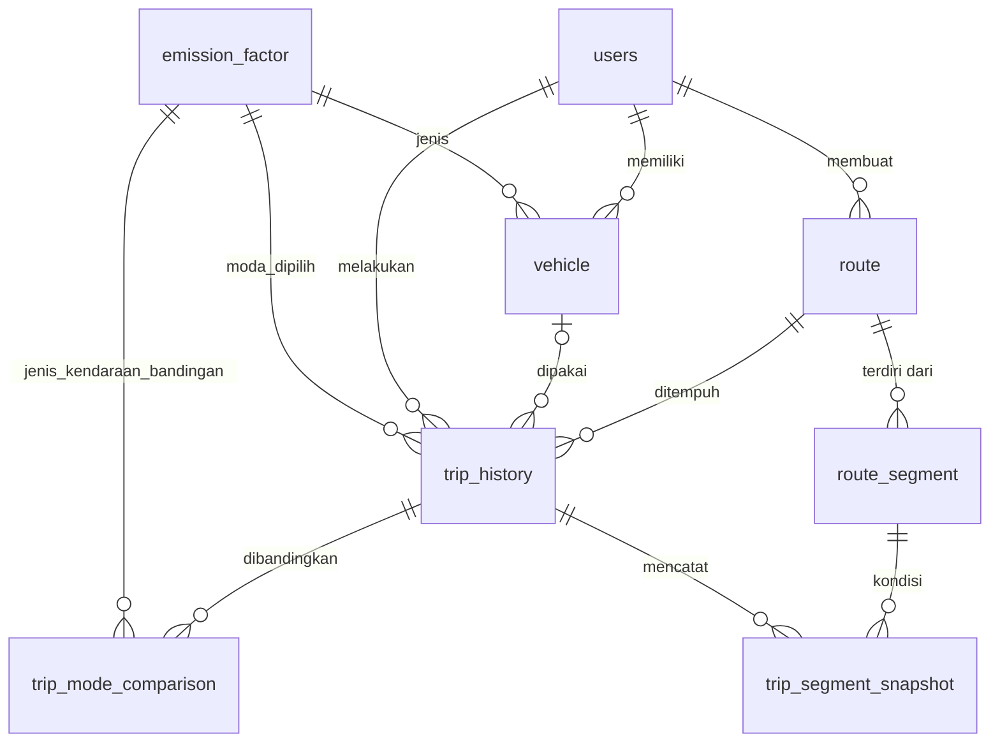

# EcoRoute Database

Skema PostgreSQL dan data contoh untuk EcoRoute. Nama tabel dan kolom memakai `snake_case`, jadi query Npgsql tidak perlu tanda kutip pada identifier.

## File

| File | Isi |
| --- | --- |
| `schema.sql` | `DROP` lalu `CREATE` semua tabel, index, dan view. **Menjalankannya menghapus semua data.** |
| `seed.sql` | Data dummy (lokasi di Yogyakarta). Mengosongkan tabel dulu, jadi aman dijalankan ulang. |
| `test_queries.sql` | Query uji: cek isi tabel, ambil riwayat, simpan perjalanan, uji constraint. Semua perubahan di-rollback di akhir. |

## Setup (psql)

Jalankan dari root repository. Server lokal default ada di port `5432`, kalau beda tambahkan `-p <port>`.

```bash
createdb -U postgres ecoroute                                        # sekali saja
psql -U postgres -v ON_ERROR_STOP=1 -d ecoroute -f EcoRoute/Database/schema.sql
psql -U postgres -v ON_ERROR_STOP=1 -d ecoroute -f EcoRoute/Database/seed.sql
psql -U postgres -v ON_ERROR_STOP=1 -d ecoroute -f EcoRoute/Database/test_queries.sql
```

Di Windows, `psql` dan `createdb` ada di `C:\Program Files\PostgreSQL\18\bin` kalau belum masuk PATH.

`-v ON_ERROR_STOP=1` membuat psql berhenti di error pertama. Tiap file berjalan dalam satu transaksi, jadi kalau gagal database tidak berubah.

## Setup (pgAdmin)

1. Klik kanan **Databases** → **Create** → **Database...**, beri nama `ecoroute`.
2. Klik kanan database `ecoroute` → **Query Tool**.
3. Buka `schema.sql` (ikon folder), jalankan dengan **F5**. Ulangi untuk `seed.sql`.
4. Untuk uji, jalankan query bagian 3, 4, 7, 8 dari `test_queries.sql`. Perintah yang diawali `\` (`\dt`, `\echo`, `\set`) hanya jalan di psql, lewati saja di pgAdmin.

## Struktur Tabel



| Tabel | Fungsi | Primary key | Relasi |
| --- | --- | --- | --- |
| `emission_factor` | Master 6 moda: faktor emisi (kg CO₂/km) dan penalti macet | `emission_factor_id` | `jenis_kendaraan` unik, dirujuk oleh `trip_history` dan `trip_mode_comparison` |
| `users` | Pengguna aplikasi | `user_id` | |
| `vehicle` | Kendaraan pribadi milik user (opsional) | `vehicle_id` | → `users`, → `emission_factor` |
| `route` | Satu rute yang dihitung: nama dan koordinat asal/tujuan, jarak, waktu | `route_id` | → `users` |
| `route_segment` | Potongan rute (untuk fitur warna macet) | `segment_id` | → `route` |
| `trip_history` | **Riwayat perjalanan**: moda yang dipilih dan total emisi | `trip_id` | → `users`, → `route`, → `vehicle` (boleh NULL), → `emission_factor` |
| `trip_mode_comparison` | Emisi moda lain untuk perjalanan yang sama (bar perbandingan State D) | `comparison_id` | → `trip_history`, → `emission_factor` |
| `trip_segment_snapshot` | Kondisi macet per segmen saat perjalanan | `snapshot_id` | → `trip_history`, → `route_segment` |
| `v_riwayat_perjalanan` (view) | Gabungan `trip_history` + `route` + `users`, siap ditampilkan | — | |

Untuk fitur wajib (simpan dan ambil riwayat), cukup pakai `emission_factor`, `users`, `route`, `trip_history`, dan view `v_riwayat_perjalanan`. Tabel lain untuk fitur lanjutan.

### Kolom penting

- `emission_factor.kategori`: `'bermotor'` → buat `KendaraanBermotor`, `'aktif'` → buat `TransportasiAktif` (lihat `docs/OOP.md`).
- `emission_factor.jenis_kendaraan`: `Motor`, `Mobil`, `Bus`, `Kereta`, `Sepeda`, `Jalan Kaki`. Harus sama persis dengan `Nama` di `MainViewModel.DaftarModa`.
- `trip_history.total_emisi_kg` = `jarak × faktor_emisi_dasar × faktor_penalti_kemacetan`, sama dengan `KendaraanBermotor.HitungEmisi()`.
- `trip_history.vehicle_id` NULL kalau tidak memakai kendaraan pribadi (Bus, Kereta, Sepeda, Jalan Kaki).

### Constraint yang dijaga database

- `moda_dipilih` harus ada di `emission_factor` (foreign key), jadi moda seperti `'Pesawat'` ditolak.
- Emisi, jarak, dan waktu tidak boleh negatif. Penalti macet minimal 1.0. Moda `aktif` wajib faktor emisi 0.
- Latitude −90..90, longitude −180..180.
- Menghapus user ikut menghapus kendaraan, rute, dan riwayatnya (`ON DELETE CASCADE`).

## Catatan untuk integrasi C# (Npgsql)

Connection string (sesuaikan password, jangan di-commit):

```
Host=localhost;Port=5432;Database=ecoroute;Username=postgres;Password=<password>
```

Query yang dipakai aplikasi ada di `test_queries.sql` (bagian bertanda `[APP]`):

```sql
-- Ambil faktor emisi untuk DaftarModa
SELECT jenis_kendaraan, kategori, faktor_emisi_dasar, faktor_penalti_kemacetan
FROM emission_factor ORDER BY emission_factor_id;

-- Ambil riwayat
SELECT trip_id, tanggal, nama_asal, nama_tujuan, jarak_km, moda_dipilih, total_emisi_kg
FROM v_riwayat_perjalanan WHERE user_id = @user_id ORDER BY tanggal DESC;

-- Simpan perjalanan: insert route dulu, lalu trip_history memakai route_id yang dikembalikan
INSERT INTO route (user_id, nama_asal, nama_tujuan, titik_awal_lat, titik_awal_lng,
                   titik_akhir_lat, titik_akhir_lng, jarak, estimasi_waktu)
VALUES (@user_id, @nama_asal, @nama_tujuan, @lat1, @lng1, @lat2, @lng2, @jarak, @waktu)
RETURNING route_id;

INSERT INTO trip_history (user_id, route_id, moda_dipilih, total_emisi_kg)
VALUES (@user_id, @route_id, @moda, @emisi)
RETURNING trip_id;
```

- Aplikasi belum punya login, jadi pakai `user_id = 3` (data dummy) sebagai user default.
- Kolom `NUMERIC` terbaca sebagai `decimal` di C#. Konversi ke `double` kalau perlu (`Convert.ToDouble`).
- Jalankan dua `INSERT` simpan perjalanan dalam satu `NpgsqlTransaction` supaya tidak ada rute tanpa riwayat.
